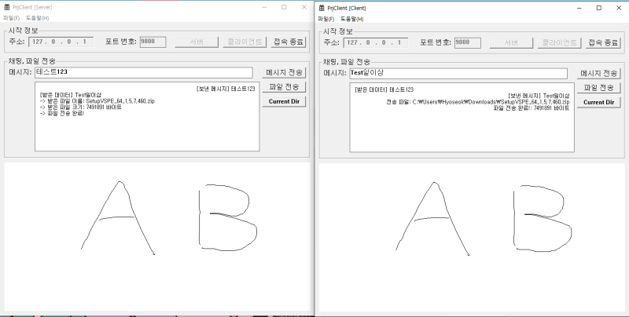

# SockSC_App
한빛미디어 원도우 네트워크 프로그래밍 Chapter13
  
TCP 기반 서버/클라이언트를 구현 
일반적 Text 메시지 전송 
파일 전송 가능 
Current Dir 버튼 
&nbsp; 1. 처음 실행시 exe 파일의 위치를 반환 
&nbsp; 2. 만약 파일 전송을 실행 후 
&nbsp; &nbsp; 전송한 파일이 다른 위치에 있다면 
&nbsp; &nbsp; 전송한 파일의 위치가 Current Dir로 변경됨 
  

